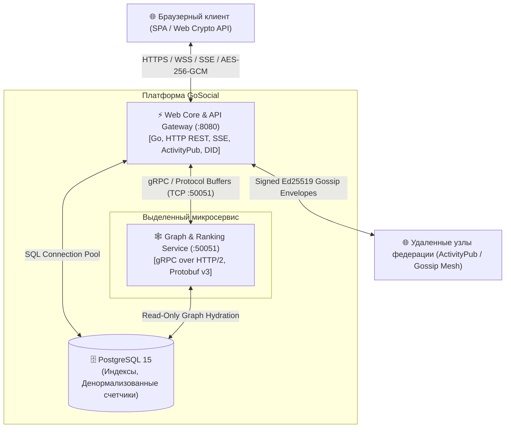

# ⚡ GoSocial — Масштабируемая децентрализованная социальная платформа

[](https://golang.org)
[](https://www.postgresql.org)
[](https://grpc.io)
[](https://protobuf.dev)
[](https://www.w3.org/TR/WebCryptoAPI/)
[](https://www.w3.org/TR/activitypub/)
[](https://www.w3.org/TR/did-core/)
[](https://www.docker.com)

> **Главная цель проекта:**  
> Проектирование, оптимизация и программная реализация масштабируемой децентрализованной социальной платформы на базе **микросервисной архитектуры** с интеграцией **графовых структур данных**, алгоритмов **персонализированного ранжирования контента** и сквозных протоколов **криптографической защиты цифровой приватности пользователей**.

Интерфейс платформы выполнен в неоновой эстетике **Cyberpunk 2077 / Obsidian Dark** с живой реактивностью через **Server-Sent Events (SSE)**, интерактивным Canvas-графом связей, сквозным шифрованием сообщений на базе аппаратного криптографического API браузера, децентрализованной Mesh-федерацией узлов и глубокой системой геймификации.

---

## 🏛️ Архитектура платформы

Проект физически разделен на независимые слабосвязанные сервисы, оркестрируемые через **Docker Compose**:



### Компоненты системы:
1. **Web Core & API Gateway (`cmd/server`)**:
   - Точка входа для клиентских HTTP/SSE запросов (порт `8080`);
   - Аутентификация сессий (bcrypt + secure cookie);
   - Управление профилями, публикациями, комментариями и личными сообщениями;
   - Реализация стандартов W3C ActivityPub, RFC 7033 WebFinger и W3C DID Resolver;
   - gRPC-клиент с пулом соединений и **Graceful Fallback** (автоматический переход на резервный in-process движок при недоступности микросервиса).
2. **Graph & Ranking Microservice (`cmd/graph_service`)**:
   - Автономный gRPC-микросервис (порт `50051`), реализующий контракт `proto/graph_ranking.proto`;
   - Построение взвешенного ориентированного графа связей пользователей;
   - Вычисление статической важности узлов методом **PageRank**;
   - Поиск кратчайших путей рукопожатий алгоритмом **BFS**;
   - Многофакторный скоринг и интеллектуальное ранжирование ленты новостей.
3. **Хранилище данных (PostgreSQL 15)**:
   - Реляционные таблицы со строгими внешними ключами и составными индексами;
   - Денормализованные счетчики для достижения субмиллисекундного отклика ленты (`0.241 мс`).

---

## 🚀 Ключевые технологические модули

### 1. 🕸️ Графовый движок (Social Graph & PageRank & BFS)
- **Топология графа**: каждый пользователь — узел; взаимные подписки, лайки и взаимодействия формируют ориентированные взвешенные ребра.
- **Алгоритм PageRank**: рассчитывает авторитетность узлов с коэффициентом затухания $\alpha = 0.85$:
  $$PR(u) = \frac{1 - \alpha}{N} + \alpha \sum_{v \in B_u} \frac{PR(v)}{L(v)}$$
- **Теория шести рукопожатий (BFS)**: нахождение минимального пути доверия и знакомства между любыми двумя пользователями сети.
- **Интерактивная визуализация**: Canvas-карта связей с физической моделью отталкивания узлов (Force-Directed Graph) и подсветкой степени близости.

### 2. ⚡ Интеллектуальное персонализированное ранжирование контента
Ранжирование постов осуществляется по комплексной многофакторной формуле релевантности:

$$\text{Score} = w_{\text{aff}} \cdot \text{Affinity} + w_{\text{fresh}} \cdot e^{-\lambda \Delta t} + w_{\text{eng}} \cdot \ln(1 + \text{Reactions}) + w_{\text{topic}} \cdot \text{TopicMatch} - \text{Penalty}$$

- **Affinity (Близость в графе)**: вес связи автора с читателем в социальном графе (прямая подписка, общие друзья, взаимные лайки).
- **Freshness (Экспоненциальное затухание по времени)**: свежие публикации получают преимущество с периодом полураспада.
- **Engagement (Вовлеченность аудитории)**: логарифмическая шкала реакций, предотвращающая доминирование кликбейта.
- **Diversity Penalty**: штраф за чрезмерное количество постов подряд от одного автора для разнообразия ленты.
- **Прозрачность алгоритмов (Explainable AI)**: модальное окно «Почему этот пост в топе?», визуализирующее вклад каждого фактора в итоговый балл.

### 3. 🔐 Сквозная криптографическая защита (E2EE & W3C Web Crypto API)
- **Бэкенд-криптография (Go)**:
  - `crypto/ed25519` — генерация ключей и проверка цифровых подписей федеративных пакетов;
  - `golang.org/x/crypto/curve25519` — протокол Диффи-Хеллмана (X25519) для безопасного согласования общего секрета.
- **Клиентская криптография в браузере**:
  - Нативный аппаратный стандарт **W3C Web Cryptography API** (`window.crypto.subtle`);
  - Симметричное шифрование сообщений по стандарту **AES-256-GCM**;
  - Криптографически стойкий 96-битный вектор инициализации (IV) через `window.crypto.getRandomValues(new Uint8Array(12))`;
  - 128-битный аутентификационный тег для защиты от подделки и MITM-атак;
  - Интерактивная маркировка сообщений бейджем **`🔐 E2EE (Web Crypto API)`**.
- **Контроль безопасности**: вычисление 60-значного защитного отпечатка безопасности (**Safety Number Fingerprint**) для верификации подлинности открытых ключей собеседников.

### 4. 🌐 Стандартизация федерации (W3C ActivityPub / RFC 7033 / DID)
- **RFC 7033 WebFinger Discovery**: эндпоинт `/.well-known/webfinger?resource=acct:user@domain` для глобального поиска акторов.
- **W3C ActivityStreams 2.0 / ActivityPub Actor**: профили пользователей доступны как машиночитаемые JSON-LD документы (`/api/activitypub/users/{id}`) с открытыми PEM-ключами, ActivityPub `inbox` и `outbox`.
- **W3C DID Core 1.0 (Decentralized Identifiers)**: поддержка децентрализованных идентификаторов `did:gosocial:user:{id}` с резолвером `/api/did/users/{id}` (методы `Ed25519VerificationKey2020` и `X25519KeyAgreementKey2020`).
- **Gossip Protocol Mesh**: распределенный обмен криптографически подписанными Ed25519-конвертами между независимыми нодами платформы с динамическим мониторингом задержки и доступности.

### 5. 🎮 Геймификация и система достижений
- **50 уникальных достижений** четырех категорий редкости: Обычные, Необычные, Редкие и Легендарные.
- **Динамический расчет опыта (XP) и уровней профиля** (от Кибер-Новичка до Легенды Сети).
- **Публичный аудит**: возможность инспекции витрины выполненных достижений других пользователей прямо из их профиля.

---

## 🧪 Запуск тестов в одну команду

Проект покрыт автоматическими тестами (криптография, граф, ранжирование, федерация, изоляция переписки, права доступа):

```bash
go test -v ./...
```

### Что проверяют автоматические тесты:
1. **Криптография (`internal/crypto`)**: генерация пар ключей Ed25519/X25519, согласование секрета ECDH, корректность симметричного шифрования AES-256-GCM и проверка цифровых подписей.
2. **Граф связей (`internal/graph`)**: корректность алгоритма BFS, топологическая дистанция, расчет PageRank и генерация персональных рекомендаций.
3. **Ранжирование контента (`internal/ranking`)**: расчет многофакторного скоринга, штрафы за дублирование авторов, сортировка ленты.
4. **Федерация (`internal/federation`)**: верификация Ed25519-конвертов, защита от replay-атак, валидация JSON-LD спецификаций.
5. **Изоляция переписки и безопасность API (`internal/handlers`)**:
   - Пользователь C **не может прочитать диалог A–B** (сервер возвращает пустой список или `403 Forbidden`);
   - Защита от неавторизованного доступа: неаутентифицированные запросы отклоняются с кодом `401 Unauthorized`;
   - Защита от модификации чужих записей: возвращается `403 Forbidden`.

---

## 🐳 Запуск через Docker Compose (Рекомендуемый)

Полный стек (PostgreSQL, микросервис графа и ранжирования, Web/API Gateway) разворачивается одной командой:

```bash
docker-compose up --build
```

После старта сервисы доступны по адресам:
- **Веб-интерфейс и API Gateway**: [http://localhost:8080](http://localhost:8080)
- **gRPC Graph & Ranking Service**: `localhost:50051`
- **PostgreSQL**: `localhost:1357` (или внутренний порт `5432`)

---

## 💻 Локальный запуск без Docker

### 1. Требования
- **Go 1.25+**
- **PostgreSQL 14+** (запущен на порту `1357` или `5432`)
- **Protocol Buffers компилятор (protoc)** *(только при изменении .proto файлов)*

### 2. Конфигурация (.env)
```env
PORT=8080
GRPC_PORT=50051
GRAPH_SERVICE_ADDR=localhost:50051
DB_HOST=localhost
DB_PORT=1357
DB_USER=postgres
DB_PASSWORD=root111
DB_NAME=gosocial
DB_SSLMODE=disable
```

### 3. Запуск сервисов в отдельных терминалах
**Терминал 1 (Микросервис графа и ранжирования):**
```bash
go run ./cmd/graph_service
```

**Терминал 2 (Web Core & API Gateway):**
```bash
go run ./cmd/server
```

*(Либо сборка бинарников: `go build -o graph_service.exe ./cmd/graph_service` и `go build -o server.exe ./cmd/server`)*

---

## 📊 Результаты оптимизации производительности (EXPLAIN ANALYZE)

В ходе разработки архитектуры выборки ленты публикаций на базе с **10 005 записями** были проведены сравнительные замеры планов выполнения PostgreSQL:

| Подход к подсчету реакций и комментариев | План выполнения PostgreSQL | Время выполнения | Буферы (shared hit) | Сравнение |
| :--- | :--- | :--- | :--- | :--- |
| **Вариант 1:** Скалярные подзапросы `COUNT(*)` в SELECT | Index Scan + 2 SubPlans per row | **0.482 мс** | 129 буферов | Базовый уровень |
| **Вариант 2A:** `LEFT JOIN likes + comments` + `GROUP BY` | Merge Left Join + Full Aggregation | **90.518 мс** | 18 636 буферов | **в 187 раз медленнее** (декартово произведение) |
| **Вариант 2B:** CTE Top-20 + `LEFT JOIN` с группировкой | CTE Scan + HashAggregate | **12.923 мс** | 122 буфера | в 26 раз медленнее |
| **Вариант 3 (Реализован):** **Денормализованные счетчики в таблице posts** | Чистый Index Scan по индексу ленты | **0.241 мс** | **28 буферов** | 🚀 **В 2 раза быстрее Варианта 1 и в 375 раз быстрее Варианта 2A!** |

---

## 📡 Основные эндпоинты платформы

### gRPC Contract (`proto/graph_ranking.proto`)
| RPC Метод | Request | Response | Назначение |
|---|---|---|---|
| `GetTopology` | `TopologyRequest` | `TopologyResponse` | Выгрузка эго-графа, матрицы смежности и PageRank |
| `GetShortestPath` | `PathRequest` | `PathResponse` | Поиск кратчайшего маршрута через BFS |
| `GetRecommendations` | `RecommendationRequest` | `RecommendationResponse` | Рекомендации друзей на основе топологии |
| `RankFeed` | `RankFeedRequest` | `RankFeedResponse` | Распределенный скоринг постов ленты |
| `ExplainRanking` | `ExplainRequest` | `ExplainResponse` | Факторная декомпозиция весов ранжирования |

### REST & Standards API
| Метод | Эндпоинт | Стандарт / Спецификация | Назначение |
|---|---|---|---|
| `GET` | `/.well-known/webfinger` | **RFC 7033 WebFinger** | Обнаружение пользователя в федерации |
| `GET` | `/api/activitypub/users/{id}` | **W3C ActivityPub Actor** | JSON-LD профиль актора с открытыми PEM-ключами |
| `POST` | `/api/activitypub/inbox` | **W3C ActivityPub Inbox** | Прием входящих федеративных активностей |
| `GET` | `/api/did/users/{id}` | **W3C DID Core 1.0** | Резолвер децентрализованного идентификатора |
| `GET` | `/api/crypto/keys/{userId}` | **E2EE Identity** | Получение публичных ключей Ed25519 и X25519 |
| `POST` | `/api/crypto/keys` | **E2EE Identity** | Регистрация открытых ключей клиента |
| `GET` | `/api/graph/topology` | **Social Graph** | Топология связей текущего пользователя |
| `GET` | `/api/graph/path/{targetId}` | **Six Degrees of Separation** | Минимальная цепочка знакомств (BFS) |
| `GET` | `/api/posts/ranked` | **Smart Ranking** | Персонализированная многофакторная лента |
| `GET` | `/api/posts/{id}/explain` | **Explainable Ranking** | Объяснение факторов ранжирования поста |
| `GET` | `/api/achievements/user/{id}` | **Gamification** | Просмотр достижений и прогресса пользователя |
| `GET` | `/api/federation/nodes` | **Mesh Federation** | Список и пинг активных узлов федерации |
| `POST` | `/api/messages` | **E2EE Direct Messages** | Отправка зашифрованного сообщения (AES-256-GCM) |
| `GET` | `/api/events` | **Real-time SSE** | Поток событий в реальном времени (Server-Sent Events) |

---

## 👥 Команда проекта
- **Переверзев Максим** — Проектирование микросервисной архитектуры, реализация gRPC-сервиса графа и ранжирования на Protocol Buffers, алгоритмы PageRank и BFS, криптографический конвейер (Ed25519/X25519 и W3C Web Crypto API AES-256-GCM), интеграция стандартов W3C ActivityPub, RFC 7033 WebFinger и W3C DID, реляционная модель PostgreSQL 15, бенчмаркинг EXPLAIN ANALYZE, автоматические тесты.
- **Чухров Степан** — Проектирование и верстка SPA-клиента в эстетике Cyberpunk Obsidian Dark, интерактивная Canvas-визуализация топологии графа связей, E2EE-интерфейс управления сквозным шифрованием и верификацией Safety Number в чате, система геймификации и карточки 50 достижений, витрина цифровых артефактов и адаптивная верстка страниц федерации.
